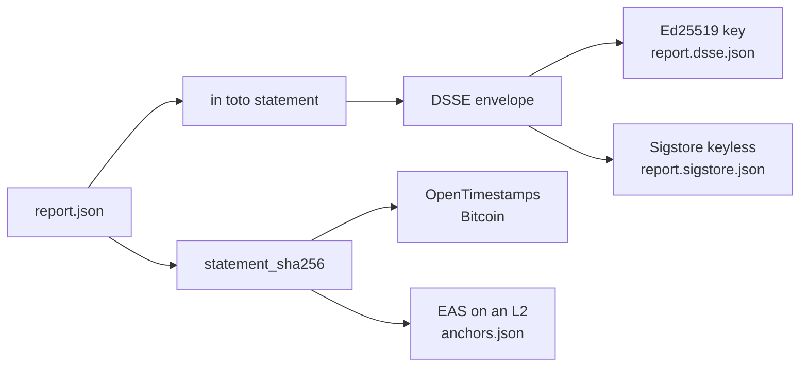

# Attestations

How a report becomes a signed in toto statement that cosign, policy engines and people can check.

A verified report proves that its claims are consistent and that it refers to exact model files. It does not say who stands behind it. An attestation adds that: a signature over a small statement that names the models, the suite, the results and the verdict.



## The statement

`modeldiffr sign` builds an [in toto Statement v1](https://github.com/in-toto/attestation/blob/main/spec/v1/statement.md) from the report. Nothing in it is new information; every field is copied from fields that `verify` already checks.

```json
{
  "_type": "https://in-toto.io/Statement/v1",
  "subject": [
    {"name": "base:Qwen/Qwen2.5-0.5B-Instruct", "digest": {"sha256": "9c1f..."}},
    {"name": "derivative:org/qwen-ft", "digest": {"sha256": "41aa..."}},
    {"name": "modeldiffr:audit", "digest": {"sha256": "71e1..."}}
  ],
  "predicateType": "https://modeldiffr.dev/attestation/audit/v1",
  "predicate": {
    "audit_id": "mdr1:71e1...",
    "schema_version": "0.3",
    "modeldiffr_version": "0.4.0",
    "created_at": "2026-10-22T10:31:02+00:00",
    "base": {"model_id": "Qwen/Qwen2.5-0.5B-Instruct", "weights_root": "sha256:9c1f..."},
    "derivative": {"model_id": "org/qwen-ft", "weights_root": "sha256:41aa..."},
    "suite": {"name": "lite", "root": "sha256:..."},
    "results_root": "sha256:...",
    "statement_sha256": "sha256:...",
    "verdict": {"any_change": true, "changed": ["gsm8k_accuracy"]},
    "metrics": [{"name": "gsm8k_accuracy", "delta": -0.041, "ci_low": -0.07, "ci_high": -0.012}]
  }
}
```

| Subject | Digest |
| --- | --- |
| `base:MODEL` | Weight Merkle root of the base model, when it was hashed |
| `derivative:MODEL` | Weight Merkle root of the derivative model |
| `modeldiffr:audit` | The audit id without its `mdr1:` prefix |

Subjects use the same digests as the report, so a policy engine can ask "is there a signed audit for the weights I am about to deploy" by looking up the weight root alone.

## Binding

A valid signature is not enough. `verify` also checks that the signed statement belongs to this report: the audit id, results root, statement hash and verdict in the predicate must equal the report's own. A signature copied from another audit fails with a message such as `signed audit_id does not match the report`.

## Envelopes

Both signing methods wrap the statement in a [DSSE](https://github.com/secure-systems-lab/dsse) envelope with payload type `application/vnd.in-toto+json`. The signature covers the pre authentication encoding `DSSEv1 <len> <type> <len> <payload>`, so the payload type cannot be swapped.

| File | Method | Trust comes from |
| --- | --- | --- |
| `report.dsse.json` | Ed25519 key from `modeldiffr keygen` | The public key you publish |
| `report.sigstore.json` | Sigstore keyless | An OpenID Connect identity, a Fulcio certificate and an entry in the Rekor transparency log |

The Sigstore bundle is a standard bundle, so `cosign verify-blob-attestation` and `sigstore verify` read it too.

## Timestamps

Signatures say who. Timestamps say when, without trusting the signer's clock. Both anchors cover `statement_sha256`, which already commits to every claim in the report.

* **OpenTimestamps** aggregates many hashes into one Bitcoin transaction. It is free, needs no account, and completes after a few hours.
* **Ethereum Attestation Service** writes one attestation on an L2 such as Base. It costs a fraction of a cent and is readable by any contract.

Only hashes leave your machine. No model names, prompts or outputs go on chain.

## Commit and reveal

For a private holdout suite, publish its Merkle root before the audit and the rows afterwards. `modeldiffr commit` hashes every row of a JSONL file with canonical JSON, so key order and whitespace do not matter, and `modeldiffr reveal` checks a file against the commitment later. Anchor the commitment file with OpenTimestamps to prove it existed before the models were trained.

## What an attestation does not prove

It proves that a key or identity vouched for a report at a time. It does not prove that the audit was run honestly on the claimed hardware; anyone with the models can rerun it and compare. See [Limitations](../limitations.md).
