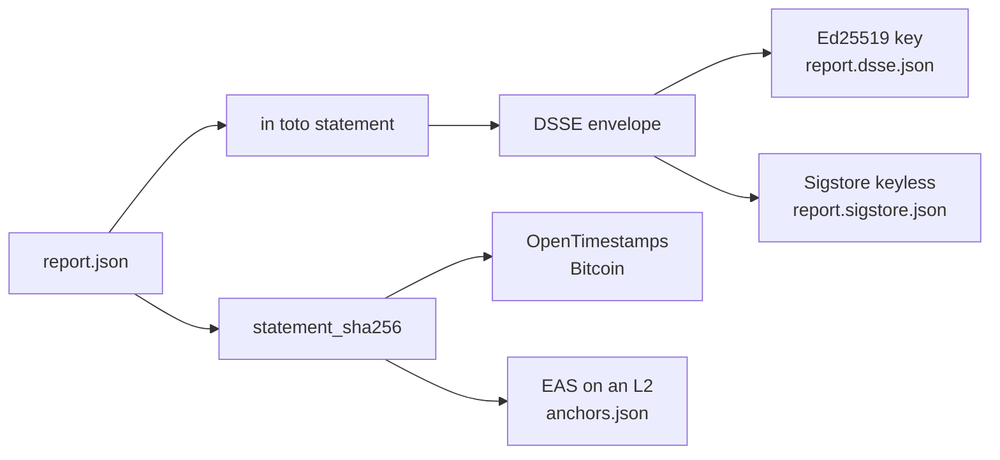

# Attestations

How a report becomes a signed statement that tools and people can check.

## Why

`verify` proves a report is consistent and points to exact model files. It does not say **who** stands behind it. An attestation adds that: a signature over a small statement that names the models, the questions, the results and the verdict.



## The statement

`modeldiffr sign` builds an [in toto Statement v1](https://github.com/in-toto/attestation/blob/main/spec/v1/statement.md) from the report. It adds no new information. Every field is copied from fields that `verify` already checks.

```json
{
  "_type": "https://in-toto.io/Statement/v1",
  "subject": [
    {"name": "base:Qwen/Qwen2.5-0.5B-Instruct", "digest": {"sha256": "9c1f..."}},
    {"name": "derivative:org/qwen-ft", "digest": {"sha256": "41aa..."}},
    {"name": "modeldiffr:audit", "digest": {"sha256": "71e1..."}}
  ],
  "predicateType": "https://modeldiffr.dev/attestation/audit/v1",
  "predicate": {
    "audit_id": "mdr1:71e1...",
    "schema_version": "0.3",
    "modeldiffr_version": "0.9.3",
    "created_at": "2026-10-22T10:31:02+00:00",
    "base": {"model_id": "Qwen/Qwen2.5-0.5B-Instruct", "weights_root": "sha256:9c1f..."},
    "derivative": {"model_id": "org/qwen-ft", "weights_root": "sha256:41aa..."},
    "suite": {"name": "lite", "root": "sha256:..."},
    "results_root": "sha256:...",
    "statement_sha256": "sha256:...",
    "verdict": {"any_change": true, "changed": ["gsm8k_accuracy"]},
    "metrics": [{"name": "gsm8k_accuracy", "delta": -0.041, "ci_low": -0.07, "ci_high": -0.012}]
  }
}
```

| Subject | Digest |
| --- | --- |
| `base:MODEL` | Weights root of the base model, when it was hashed |
| `derivative:MODEL` | Weights root of the derivative |
| `modeldiffr:audit` | The audit id without `mdr1:` |

Subjects use the same hashes as the report. So a deploy policy can ask "is there a signed audit for the weights I am about to ship?" using only the weights root.

## Binding

A valid signature is not enough on its own. `verify` also checks that the signed statement belongs to **this** report: the audit id, results root, statement hash and verdict must match. A signature copied from another audit fails with a message like `signed audit_id does not match the report`.

## Envelopes

Both signing methods wrap the statement in a [DSSE](https://github.com/secure-systems-lab/dsse) envelope with the type `application/vnd.in-toto+json`. The signature also covers the type, so nobody can swap it.

| File | Method | Trust comes from |
| --- | --- | --- |
| `report.dsse.json` | Ed25519 key from `modeldiffr keygen` | The public key you publish |
| `report.sigstore.json` | Sigstore keyless | An OpenID Connect identity (for example your GitHub login), a Fulcio certificate and an entry in the public Rekor log |

The Sigstore file is a standard bundle, so `cosign verify-blob-attestation` and `sigstore verify` can read it too.

## Timestamps

A signature says who. A timestamp says when, without trusting the signer's clock. Both options timestamp `statement_sha256`, which already covers every claim.

* **OpenTimestamps** puts many hashes into one Bitcoin transaction. Free, no account, done after a few hours.
* **Ethereum Attestation Service** writes one record on an L2 such as Base. Costs a fraction of a cent, and any smart contract can read it.

Only hashes leave your machine. No model names, prompts or outputs go on chain.

## Commit and reveal

For a private test set: publish its root hash **before** the audit and the rows **after**. `modeldiffr commit` hashes every row of a JSONL file, and `modeldiffr reveal` checks a file against that hash later. Timestamp the commitment with OpenTimestamps to prove it existed before the models were trained, so nobody could have trained on it.

## What an attestation does not prove

It proves that a key or identity vouched for a report at a certain time. It does not prove the audit was run honestly on the claimed hardware. Anyone with the models can rerun it and compare. See [Limitations](../limitations.md).