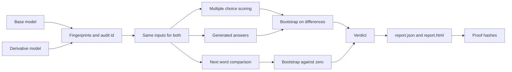

# How it works

What happens when you run an audit, step by step.

## The idea

An audit is a fair test. Two models take the same exam, under the same rules, and Modeldiffr checks whether the difference in their results is real or just luck. The only thing allowed to change between the two runs is the model. Inputs, settings, precision, device and scoring stay the same.



## Step 1. Take fingerprints and name the audit

Before anything runs, Modeldiffr hashes:

* every weight tensor of both models,
* the tokenizer and vocabulary,
* the chat template.

It then checks that the pair can be compared fairly (for example, that a shared prompt template can be used), and writes down every setting. All of that together is hashed into an **audit id**, like `mdr1:71e1...`.

Why: names on the Hub can be overwritten. Hashes cannot. Two people who audit the same pair with the same settings get the same audit id, on any machine. See [Fingerprints and proof](proof.md).

This step also gives you the [weights view](layer_by_layer.md#the-weights-view): which tensors changed.

## Step 2. Load both models the same way

Both models load with the same dtype and on the same device, in evaluation mode with no gradients. You can pin exact revisions with `--base-revision` and `--derivative-revision`.

## Step 3. Score multiple choice questions by likelihood

A question looks like this:

```text
Question: What is 7 multiplied by 8?
Answer:
```

Modeldiffr does not ask the model to write an answer. Instead it asks: how likely does the model think each option is, as the next words? It adds up the log probability of every token in the option, and the option with the highest total is the model's answer.

Why: if you read written answers, a chat model that says "Sure, the answer is 56!" and a base model that says "56" need a parser, and parsers make mistakes. Likelihood scoring has no parser, so formatting style cannot change the score.

## Step 4. Generate answers where writing matters

Some tests need real text: math word problems, following format instructions, and refusals. For these, each prompt goes through the chat template and the model writes a reply with greedy decoding (always the most likely next token), so the result is the same every run.

If the two models have different chat templates but the same tokenizer, both get the prompt written with **one** template, so the text is byte for byte identical. The hash of every rendered prompt is saved, so anyone can check this later.

## Step 5. Compare the next word predictions directly

On neutral text, Modeldiffr asks both models for their full probability over the next token at every position, and measures how different the two distributions are (KL divergence). This catches changes that no benchmark is looking for.

It only works when both models use the same vocabulary. If they do not, this step is skipped and the report says so.

## Step 6. Decide what is real

For each question you get a score for the base and a score for the derivative. Modeldiffr:

1. Takes the difference on every question.
2. Resamples those differences thousands of times (a paired bootstrap) to see how much the average could move by luck.
3. Builds a 95% range from that.
4. Calls a change real only if the range excludes zero, it survives a correction for testing many metrics at once, and it is bigger than a minimum size worth caring about.

Details in plain words: [Statistics](statistics.md).

## Step 7. Write and lock the report

The results go into `report.json` (everything) and `report.html` (a page for people). Every question and every per question result is hashed into one root hash (a Merkle tree), and one more hash covers every claim in the report.

`modeldiffr verify` recomputes all of this from the file. Change one number and verification fails.

## Optional: look inside

After the audit, you can go deeper. Each step tells you where to point the next one.

| Step | Command | Question |
| --- | --- | --- |
| 1 | `modeldiffr layers` | [Which layer changed?](layer_by_layer.md) |
| 2 | `modeldiffr features` | [What changed at that layer?](representational.md) |
| 3 | `modeldiffr causal` | [Does that change cause the behavior?](causal.md) |
| 4 | `modeldiffr scan` | [Is there a hidden trigger?](anomaly.md) |

## Design rules

??? note "Fair"

    Same inputs, same precision, same device, same decoding. Multiple choice is scored without reading text, so writing style cannot bias the score.

??? note "Honest about noise"

    Every number has a range. A change is reported only when the range excludes zero, so two identical models always get a clean report. This is tested with 50 seeded runs in CI.

??? note "Repeatable"

    The bootstrap is seeded, generation is greedy, and the report stores model commits, fingerprints, settings, environment and the Modeldiffr version.

??? note "Checkable"

    Every input and result is hashed into the report. `modeldiffr verify` recomputes the hashes and the metrics, so an edited report or a swapped model is caught.

??? note "Light"

    The core package imports nothing heavy. PyTorch and Transformers load only when you actually run a model.