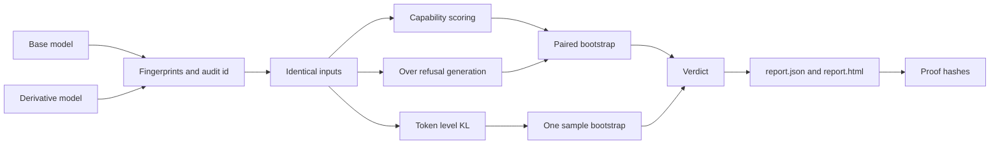

# How it works

The audit pipeline from model loading to verdict.

An audit is a controlled experiment. The only variable is the model. Everything else, inputs, dtype, device, decoding, and statistics, is held fixed.

## Pipeline

### 0. Fingerprint, check and name the audit

Both models' weights, tokenizers and chat templates are hashed. Modeldiffr checks that the pair can be compared fairly, chooses how generation prompts are rendered, and computes the audit id from everything that defines the experiment. See [Fingerprints and proof](proof.md).

### 1. Load both models identically

Both models load through `HFBackend` with the same `dtype` and `device`. Revisions can be pinned with `--base-revision` and `--derivative-revision`. Models run in eval mode with gradients disabled.

### 2. Score capability by log likelihood

Each multiple choice question is formatted as `Question: ...\nAnswer:`. Every option is scored by the summed log probability of its tokens as a continuation. The highest scoring option is the prediction. Nothing is parsed from generated text, so formatting differences between models cannot affect the score.

### 3. Generate for over refusal

Each benign prompt is wrapped in a chat template, or `User: ...\nAssistant:` when no template exists. When the two models' templates differ but their tokenizers match, both receive the prompt rendered with one template, so the text is byte identical; the hash of every rendered prompt is stored. Decoding is greedy with `max_new_tokens` set by the suite (64 for `quick`), so results are deterministic. A keyword detector classifies each response as refused or answered.

### 4. Measure output divergence

When both tokenizers have the same vocabulary signature (a SHA256 hash of the sorted vocab), Modeldiffr computes KL divergence from base to derivative at every token position of each neutral text and averages it. When the tokenizers differ, the metric is skipped and the report records a note.

### 5. Resample for confidence

Paired bootstrap resampling turns per item results into a delta with a 95% confidence interval. See [Statistics](statistics.md).

### 6. Write the reports and proof

The result dict is written as `report.json` and rendered as a self contained `report.html`.

## Design principles

??? note "Fair"

    Same inputs, same dtype, same device, same decoding. Capability is scored without answer parsing so chat formatting cannot bias the result.

??? note "Statistical"

    Every number carries an interval. A change is reported only when the interval excludes zero, which keeps identical models clean.

??? note "Repeatable"

    The bootstrap is seeded, generation is greedy, and the report stores model commits, weight fingerprints, settings, environment, and the version of Modeldiffr that produced it.

??? note "Verifiable"

    Every input and result is hashed into the report. `modeldiffr verify` recomputes the hashes and metrics, so an edited report or a swapped model is caught.

??? note "Light core"

    The core package imports nothing heavy. PyTorch and Transformers load lazily only when `HFBackend` is constructed.
