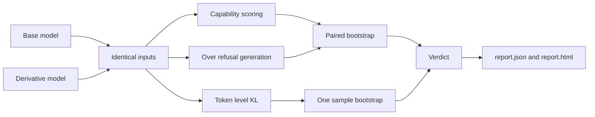

An audit is a controlled experiment. The only variable is the model. Everything else, inputs, dtype, device, decoding, and statistics, is held fixed.

## Pipeline

<Steps>
  <Step title="Load both models identically">
    Both models load through `HFBackend` with the same `dtype` and `device`. Revisions can be pinned with `--base-revision` and `--derivative-revision`. Models run in eval mode with gradients disabled.
  </Step>
  <Step title="Score capability by log likelihood">
    Each multiple choice question is formatted as `Question: ...\nAnswer:`. Every option is scored by the summed log probability of its tokens as a continuation. The highest scoring option is the prediction. Nothing is parsed from generated text, so formatting differences between models cannot affect the score.
  </Step>
  <Step title="Generate for over refusal">
    Each benign prompt is wrapped in the model's own chat template, or `User: ...\nAssistant:` when no template exists. Decoding is greedy with `max_new_tokens` set by the suite (64 for `quick`), so results are deterministic. A keyword detector classifies each response as refused or answered.
  </Step>
  <Step title="Measure output divergence">
    When both tokenizers have the same vocabulary signature (a SHA256 hash of the sorted vocab), Modeldiffr computes KL divergence from base to derivative at every token position of each neutral text and averages it. When the tokenizers differ, the metric is skipped and the report records a note.
  </Step>
  <Step title="Resample for confidence">
    Paired bootstrap resampling turns per item results into a delta with a 95% confidence interval. See [Statistics](/concepts/statistics).
  </Step>
  <Step title="Write the reports">
    The result dict is written as `report.json` and rendered as a self contained `report.html`.
  </Step>
</Steps>

## Design principles

<AccordionGroup>
  <Accordion title="Fair">
    Same inputs, same dtype, same device, same decoding. Capability is scored without answer parsing so chat formatting cannot bias the result.
  </Accordion>
  <Accordion title="Statistical">
    Every number carries an interval. A change is reported only when the interval excludes zero, which keeps identical models clean.
  </Accordion>
  <Accordion title="Repeatable">
    The bootstrap is seeded, generation is greedy, and the report stores model revisions, settings, environment, and the version of Modeldiffr that produced it.
  </Accordion>
  <Accordion title="Light core">
    The core package imports nothing heavy. PyTorch and Transformers load lazily only when `HFBackend` is constructed.
  </Accordion>
</AccordionGroup>
